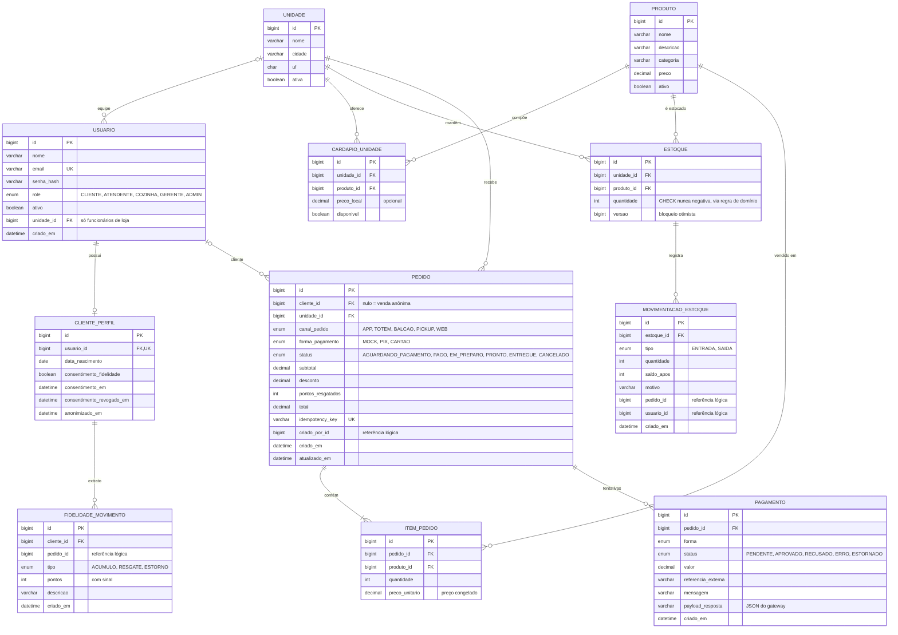

# Modelo de dados (DER)

Banco: MySQL 8. As tabelas são geradas pelo Hibernate a partir das entidades (`ddl-auto=update`).

## Restrições relevantes

| Restrição | Onde | Motivo |
|---|---|---|
| `UNIQUE (email)` | usuario | Um e-mail, uma conta |
| `UNIQUE (unidade_id, produto_id)` | cardapio_unidade e estoque | Um produto aparece uma vez por unidade |
| `UNIQUE (idempotency_key)` | pedido | Barreira final contra pedido duplicado |
| `UNIQUE (usuario_id)` | cliente_perfil | Um perfil por usuário |
| `versao` (`@Version`) | estoque | Bloqueio otimista contra venda duplicada do último item |
| Saldo nunca negativo | `Estoque.baixar()` | Regra no domínio, vale para qualquer fluxo |

## Decisões de modelagem

1. **Estoque por unidade:** `estoque` liga unidade e produto. Cada loja tem saldo próprio.
2. **Pagamento desacoplado:** tabela própria, 1:N com o pedido (cada tentativa é um registro), sem dado de cartão.
3. **Preço congelado:** `item_pedido.preco_unitario` preserva o valor da venda, mesmo que o catálogo mude.
4. **Saldo de pontos derivado:** não existe coluna de saldo. O saldo é a soma de `fidelidade_movimento.pontos`, e o extrato é imutável.
5. **Cliente do pedido aponta para `usuario`** (e não para `cliente_perfil`), porque a venda precisa funcionar sem perfil de fidelidade.
6. **Referências lógicas (sem chave estrangeira):** `pedido_id` e `usuario_id` nos movimentos, `criado_por_id` no pedido. Registros históricos não devem impedir a remoção ou anonimização dos dados referenciados.
7. **Anonimização:** a conta do cliente é anonimizada, e não apagada. Os pedidos permanecem, mas deixam de identificar a pessoa.