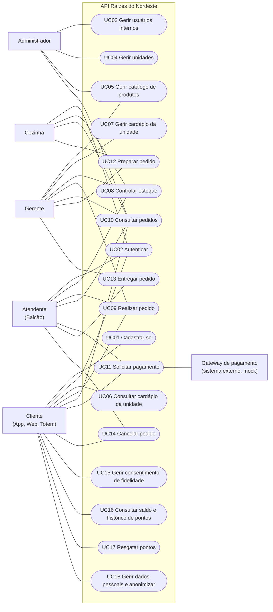
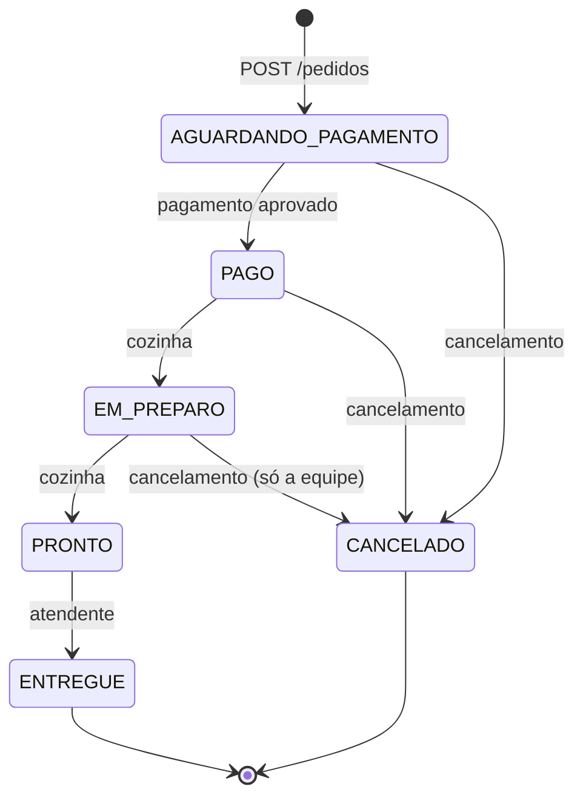
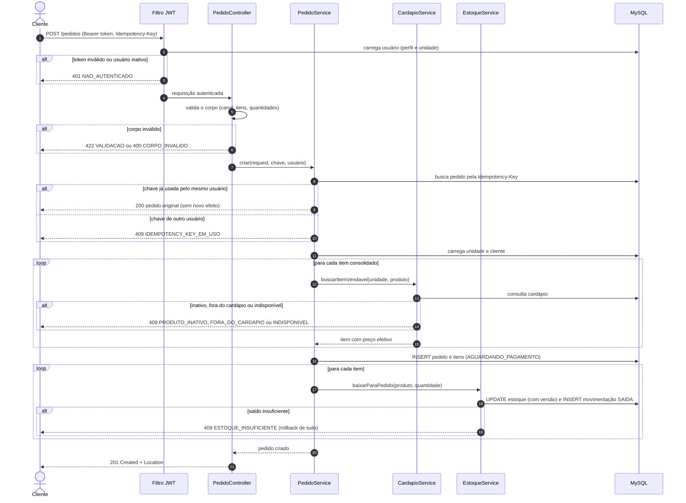
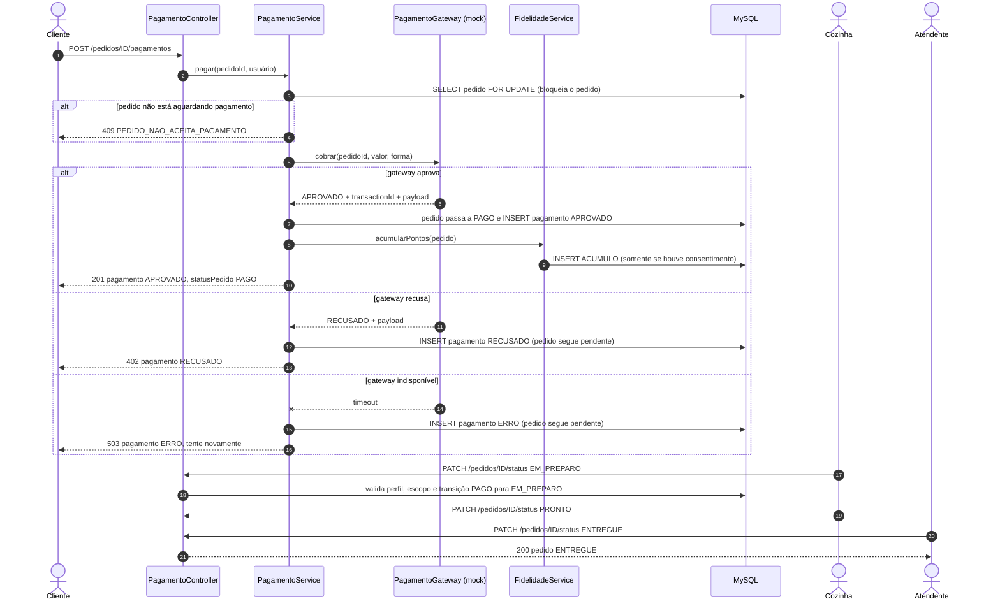
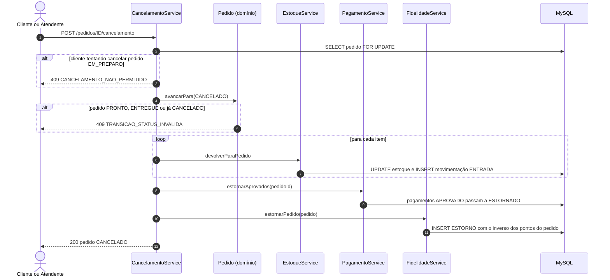

# Casos de uso e fluxos críticos

## 1. Diagrama de casos de uso

O Mermaid não tem notação UML nativa de casos de uso, então o diagrama usa `flowchart`:
retângulos são atores e elipses são casos de uso. O ADMIN herda as permissões do gerente em
todas as unidades, por isso suas ligações mostram apenas o que é exclusivo dele.

**Relações entre casos de uso**

| Relação | Descrição |
|---|---|
| UC09 **inclui** UC06 (validação) | Todo pedido valida produto ativo, disponível e presente no cardápio da unidade |
| UC09 **inclui** UC08 (baixa) | Todo pedido baixa o estoque na mesma transação |
| UC17 **estende** UC09 | O resgate de pontos é opcional e só vale para pedido aguardando pagamento |
| UC11 **estende** UC09 | O pagamento é a etapa seguinte do pedido, feita em outra chamada |
| UC14 **inclui** devolução de estoque, estorno de pagamento e estorno de pontos | Executados na mesma transação |

## 2. Catálogo de casos de uso

| ID | Caso de uso | Atores | Endpoints | Requisito |
|---|---|---|---|---|
| UC01 | Cadastrar-se | Cliente | `POST /auth/register` | RF01 |
| UC02 | Autenticar | Todos os perfis | `POST /auth/login` | RF02 |
| UC03 | Gerir usuários internos | Admin | `POST /usuarios`, `GET /usuarios/{id}` | RF03 |
| UC04 | Gerir unidades | Admin (consulta pública) | `/unidades` | RF05 |
| UC05 | Gerir catálogo de produtos | Gerente, Admin (consulta pública) | `/produtos` | RF06 |
| UC06 | Consultar cardápio da unidade | Público | `GET /unidades/{id}/cardapio` | RF07 |
| UC07 | Gerir cardápio da unidade | Gerente (da unidade), Admin | `POST/PUT /unidades/{id}/cardapio` | RF07 |
| UC08 | Controlar estoque | Gerente e Admin (escrita e leitura), Atendente e Cozinha (leitura) | `/unidades/{id}/estoque/**` | RF08 |
| UC09 | Realizar pedido | Cliente, Atendente, Gerente, Admin | `POST /pedidos` | RF09 |
| UC10 | Consultar pedidos | Cliente (os próprios), equipe (da unidade), Admin (todos) | `GET /pedidos`, `GET /pedidos/{id}` | RF10 |
| UC11 | Solicitar pagamento | Cliente, Atendente, Gerente, Admin. Gateway como sistema externo | `POST/GET /pedidos/{id}/pagamentos` | RF13 |
| UC12 | Preparar pedido (EM_PREPARO, PRONTO) | Cozinha, Gerente, Admin | `PATCH /pedidos/{id}/status` | RF11 |
| UC13 | Entregar pedido (ENTREGUE) | Atendente, Gerente, Admin | `PATCH /pedidos/{id}/status` | RF11 |
| UC14 | Cancelar pedido | Cliente (antes do preparo), Atendente, Gerente, Admin | `POST /pedidos/{id}/cancelamento` | RF12 |
| UC15 | Gerir consentimento de fidelidade | Cliente | `POST/DELETE /fidelidade/consentimento` | RF14 |
| UC16 | Consultar saldo e histórico de pontos | Cliente | `GET /fidelidade/saldo`, `GET /fidelidade/historico` | RF14 |
| UC17 | Resgatar pontos | Cliente | `POST /fidelidade/resgates` | RF14 |
| UC18 | Gerir dados pessoais e anonimizar | Cliente | `GET/PUT/DELETE /clientes/me` | RF15 |

## 3. Máquina de estados do pedido

A regra é imposta no domínio (`StatusPedido.podeIrPara`). Saltos de etapa e saídas de estados finais
retornam 409 `TRANSICAO_STATUS_INVALIDA`.

---

## 4. Descrição da feature crítica: Realizar Pedido + Solicitar Pagamento

| Item | Descrição |
|---|---|
| **Identificação** | UC09 + UC11 (com UC17 opcional) |
| **Requisitos** | RF08, RF09, RF13, RF14 |
| **Ator principal** | Cliente (App, Web ou Totem). Também o Atendente, no balcão |
| **Ator secundário** | Gateway de pagamento (mock) |
| **Objetivo** | Registrar uma compra, reservar o estoque, cobrar e deixar o pedido pronto para a cozinha |
| **Gatilho** | O ator confirma o carrinho |

### 4.1 Pré-condições

1. O ator está autenticado (token JWT válido) com perfil CLIENTE, ATENDENTE, GERENTE ou ADMIN.
2. A unidade existe e está ativa.
3. Cada produto pedido está ativo, no cardápio da unidade e marcado como disponível.
4. Há saldo em estoque para cada item.
5. Funcionários só pedem na própria unidade. O cliente pode escolher qualquer unidade.

### 4.2 Fluxo principal

**Parte 1: criar o pedido** (`POST /pedidos`)

1. O ator envia `canalPedido`, `unidadeId`, `formaPagamento` e os `itens`, e opcionalmente o header `Idempotency-Key`.
2. O sistema valida o token e o corpo (canal obrigatório, ao menos um item, quantidade entre 1 e 99).
3. O sistema confere a chave de idempotência. Sendo nova, segue.
4. O sistema confere o escopo da unidade (funcionário) e carrega a unidade.
5. O sistema define o cliente do pedido: o CLIENTE sempre compra para si. O funcionário pode informar um cliente ou deixar a venda anônima.
6. O sistema consolida linhas repetidas do mesmo produto e valida cada item contra o cardápio.
7. O sistema congela o preço de cada item (preço local da unidade, senão o do catálogo) e calcula subtotal e total.
8. O sistema grava o pedido e os itens com status `AGUARDANDO_PAGAMENTO`.
9. O sistema baixa o estoque de cada item e registra uma movimentação de `SAIDA` ligada ao pedido.
10. O sistema confirma a transação e responde **201** com o pedido e o header `Location`.

**Parte 2 (opcional): resgatar pontos** (`POST /fidelidade/resgates`)

11. O cliente com consentimento informa `pedidoId` e `pontos` (mínimo 10). O sistema aplica o desconto (R$ 0,10 por ponto), recalcula o total e registra o resgate no extrato.

**Parte 3: pagar** (`POST /pedidos/{id}/pagamentos`)

12. O ator solicita o pagamento (o corpo é opcional).
13. O sistema bloqueia o pedido para escrita e confirma que ele aguarda pagamento.
14. O sistema envia ao gateway o valor total, a forma de pagamento e o identificador do pedido.
15. O gateway aprova e devolve o identificador da transação e o payload.
16. O sistema registra o `Pagamento` (`APROVADO`), muda o pedido para `PAGO` e, se o cliente consentiu, acumula pontos (1 por real do total pago).
17. O sistema responde **201** com o resultado do pagamento e o `statusPedido: PAGO`.

A cozinha segue com `PATCH /pedidos/{id}/status` (`EM_PREPARO`, `PRONTO`) e o atendente conclui com `ENTREGUE`.

### 4.2.1 Fluxos alternativos

| ID | Situação | Comportamento |
|---|---|---|
| A1 | Mesma `Idempotency-Key` repetida pelo mesmo usuário | Nenhum pedido novo, nenhuma baixa de estoque. Responde **200** com o pedido original |
| A2 | Pagamento **recusado** pelo gateway | Registra `Pagamento` com status `RECUSADO`. O pedido continua `AGUARDANDO_PAGAMENTO` e o ator pode tentar de novo. Responde **402** |
| A3 | Gateway **indisponível** (timeout ou queda) | Registra `Pagamento` com status `ERRO`. O pedido continua pendente. Responde **503** com orientação para tentar novamente |
| A4 | Venda no balcão com cliente identificado | O atendente informa `clienteId`. O cliente precisa existir e ter perfil CLIENTE |
| A5 | Venda anônima (totem ou balcão) | `clienteId` ausente. O pedido não pontua |
| A6 | Cliente sem consentimento de fidelidade | O pagamento funciona normalmente, sem acúmulo de pontos |

### 4.3 Exceções

| Condição | HTTP | Código |
|---|---|---|
| Sem token ou token inválido | 401 | `NAO_AUTENTICADO` |
| Perfil sem permissão (ex.: COZINHA criando pedido) | 403 | `ACESSO_NEGADO` |
| Funcionário em outra unidade | 403 | `ACESSO_NEGADO` |
| `canalPedido` ausente, lista de itens vazia ou quantidade inválida | 422 | `VALIDACAO` |
| `canalPedido` com valor inexistente ou JSON malformado | 400 | `CORPO_INVALIDO` |
| Unidade, produto ou cliente inexistente | 404 | `RECURSO_NAO_ENCONTRADO` |
| Unidade inativa | 409 | `UNIDADE_INATIVA` |
| Produto desativado no catálogo | 409 | `PRODUTO_INATIVO` |
| Unidade não vende o produto | 409 | `PRODUTO_FORA_DO_CARDAPIO` |
| Produto marcado como indisponível na unidade | 409 | `PRODUTO_INDISPONIVEL` |
| Saldo insuficiente (ou produto sem registro de estoque) | 409 | `ESTOQUE_INSUFICIENTE` |
| `Idempotency-Key` já usada por outro usuário | 409 | `IDEMPOTENCY_KEY_EM_USO` |
| Alteração concorrente do mesmo estoque | 409 | `CONFLITO_CONCORRENCIA` |
| Pagamento de pedido que não está aguardando pagamento | 409 | `PEDIDO_NAO_ACEITA_PAGAMENTO` |
| Pedido de outro cliente (visão do cliente) | 404 | `RECURSO_NAO_ENCONTRADO` |
| Pagamento recusado | 402 | (corpo `PagamentoResponse`, status `RECUSADO`) |
| Gateway indisponível | 503 | (corpo `PagamentoResponse`, status `ERRO`) |

O cliente que consulta o pedido de outra pessoa recebe 404 (e não 403) para não revelar que o id existe.

### 4.4 Pós-condições

| Resultado | Estado final |
|---|---|
| **Sucesso** | Pedido `PAGO` com itens e preços congelados. Estoque reduzido e uma movimentação `SAIDA` por item. `Pagamento` `APROVADO` com a referência externa. Pontos acumulados (se houve consentimento) |
| **Falha na criação** | **Nada é gravado.** O pedido, os itens e as baixas anteriores são desfeitos na mesma transação |
| **Pagamento recusado ou com erro** | Pedido ainda `AGUARDANDO_PAGAMENTO`, estoque **mantido reservado**, tentativa registrada para consulta |

### 4.5 Regras de negócio aplicadas

RN01 (canal obrigatório), RN02 (produto vendável), RN03 (estoque suficiente), RN04 (preço congelado),
RN05 (consolidação de itens), RN06 (idempotência), RN07 (cliente do pedido), RN08 (escopo de unidade),
RN12 (pagamento só em pedido pendente), RN14 e RN15 (pontos). Ver `01-requisitos.md`.

### 4.6 Concorrência e consistência

| Risco | Proteção |
|---|---|
| Duas vendas do último item | `@Version` no estoque: a segunda recebe 409 |
| Clique duplo em "Pagar" | Bloqueio pessimista no pedido: o segundo pagamento espera, encontra `PAGO` e recebe 409 |
| Reenvio da criação do pedido | `Idempotency-Key` com `UNIQUE` no banco |
| Gastar os mesmos pontos duas vezes | Bloqueio pessimista no perfil do cliente, sempre após o bloqueio do pedido (ordem fixa, sem deadlock) |
| Falha no meio da criação | Transação única: tudo ou nada |

---

## 5. Diagramas de sequência

### 5.1 Criar pedido

### 5.2 Pagamento e atualização de status

### 5.3 Cancelamento

