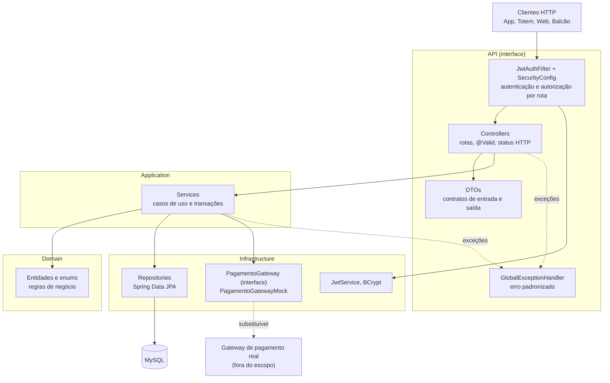
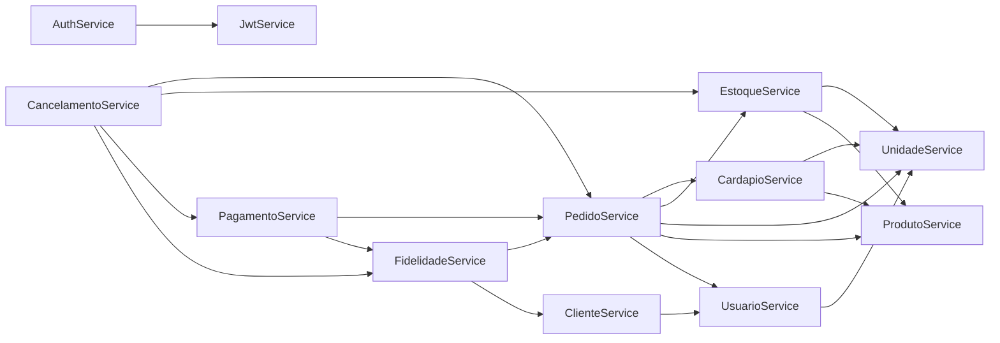
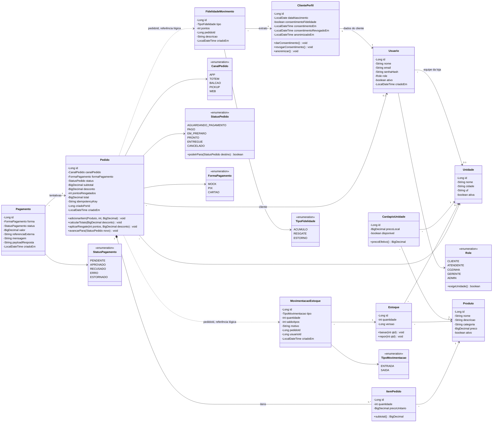
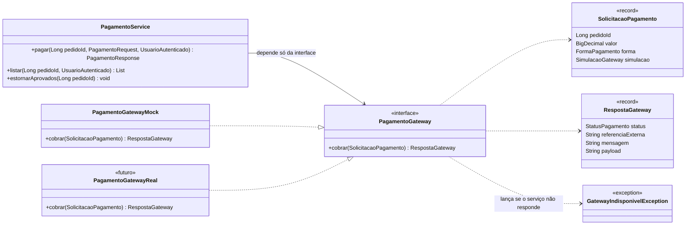
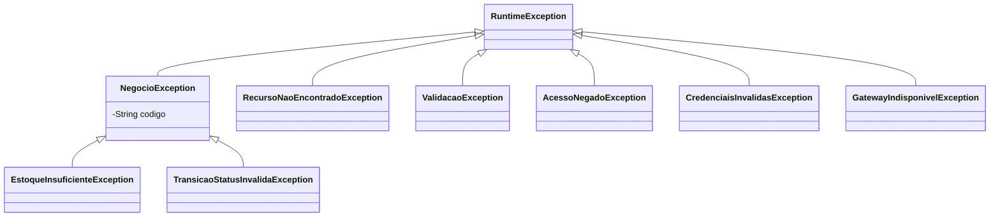

# Arquitetura e modelo de classes

## 1. Visão geral

A API segue **MVC em camadas** (Controller → Service → Repository), organizado por tipo de classe,
como o roteiro permite ("MVC, Clean Architecture ou DDD simplificado"). As quatro camadas
exigidas (Domain, Application, Infrastructure e API) estão mapeadas para os pacotes abaixo.

| Camada exigida | Pacotes | Responsabilidade |
|---|---|---|
| **Domain** | `entity`, `enums` | Entidades, regras de negócio que pertencem ao objeto (transição de status, baixa de estoque, cálculo de totais, preço efetivo, consentimento) e valores fixos |
| **Application** | `service` | Casos de uso: orquestram entidades, repositórios e gateway dentro de uma transação. Aplicam as regras que envolvem mais de um objeto (cardápio + estoque + pedido) |
| **Infrastructure** | `repository`, `gateway`, `security`, `config` | Persistência (Spring Data JPA), integração de pagamento (mock atrás de interface), JWT, BCrypt e configuração |
| **API** | `controller`, `dto`, `exception` | Rotas HTTP, contratos de request e response, validação de entrada, tratamento global de erros e autorização por rota |

## 2. Estrutura de pacotes

```
br.com.raizesdonordeste
├── RaizesApiApplication
├── controller   AuthController, UsuarioController, UnidadeController, ProdutoController,
│                CardapioController, EstoqueController, PedidoController,
│                PagamentoController, FidelidadeController, ClienteController
├── dto          Requests e Responses (records), ErroResponse, PageResponse
├── service      AuthService, UsuarioService, UnidadeService, ProdutoService,
│                CardapioService, EstoqueService, PedidoService, PagamentoService,
│                CancelamentoService, FidelidadeService, ClienteService
├── entity       Usuario, ClientePerfil, Unidade, Produto, CardapioUnidade, Estoque,
│                MovimentacaoEstoque, Pedido, ItemPedido, Pagamento, FidelidadeMovimento
├── enums        Role, CanalPedido, FormaPagamento, StatusPedido, StatusPagamento,
│                SimulacaoGateway, TipoMovimentacao, TipoFidelidade
├── repository   Um JpaRepository por entidade
├── gateway      PagamentoGateway (interface), PagamentoGatewayMock, SolicitacaoPagamento,
│                RespostaGateway, GatewayIndisponivelException
├── security     SecurityConfig, JwtService, JwtAuthFilter, UsuarioAutenticado
├── exception    GlobalExceptionHandler e as exceções de negócio
└── config       PasswordConfig
```

## 3. Diagrama de camadas



## 4. Regras de dependência

| Camada | Pode depender de | Nunca faz |
|---|---|---|
| **Controller** | Service, DTO | Regra de negócio ou acesso direto a repositório |
| **Service** | Entidades, repositórios, outros services, interface do gateway | Conhecer HTTP (`HttpServletRequest`, códigos de status) |
| **Entity** | Enums e exceções de domínio | Chamar service, repositório ou gateway |
| **Repository** | Entidades | Decidir regra de negócio |
| **Gateway** | Enums | Ser conhecido pelo domínio: o service depende só da interface |

O fluxo de uma requisição segue sempre `Filtro JWT → Controller → Service → Repository → MySQL`,
e o caminho de volta passa pelos DTOs. Qualquer exceção sobe até o `GlobalExceptionHandler`.

### Exemplo: `POST /pedidos`

| Passo | Camada | O que acontece |
|---|---|---|
| 1 | API | `JwtAuthFilter` valida o token e carrega usuário, perfil e unidade |
| 2 | API | `SecurityConfig` confere se o perfil pode chamar a rota (senão, 403) |
| 3 | API | `PedidoController` valida o corpo (`@Valid`) e delega |
| 4 | Application | `PedidoService.criar` orquestra: idempotência, escopo, cardápio, preço, totais e estoque, em **uma transação** |
| 5 | Domain | `Pedido.calcularTotais` e `Estoque.baixar` aplicam as regras do próprio objeto |
| 6 | Infrastructure | Repositories gravam pedido, itens, saldo e movimentações |
| 7 | API | O DTO `PedidoResponse` é devolvido com 201. Uma falha vira o JSON padrão de erro |

## 5. Dependências entre services

Os services se chamam entre si (e nunca acessam o repositório de outro domínio), e o grafo
**não tem ciclos**. O `CancelamentoService` existe como caso de uso separado justamente para
evitar uma dependência circular entre pedido e pagamento.



## 6. Padrões de projeto e decisões arquiteturais

| Padrão ou decisão | Onde | Por quê |
|---|---|---|
| **Repository** | Interfaces `JpaRepository` | Isola o acesso a dados. Consultas derivadas e JPQL ficam fora dos services |
| **Service Layer** | `service` | Concentra casos de uso e fronteiras de transação (`@Transactional`) |
| **DTO** | `dto` | O contrato da API não expõe entidades: nenhum campo sensível (como `senhaHash`) vaza e o cliente não altera campos internos (*mass assignment*) |
| **Adapter / Strategy** | `PagamentoGateway` e `PagamentoGatewayMock` | O sistema depende da interface. Trocar o mock por um provedor real é escrever uma classe nova, sem alterar domínio, services ou controllers |
| **Aggregate root** | `Pedido` com `ItemPedido` | Os itens só existem dentro do pedido (`cascade` e `orphanRemoval`), e o pedido garante os próprios totais e transições |
| **Rich domain model** | Entidades | As regras que dependem só do objeto vivem nele: `Estoque.baixar`, `Pedido.avancarPara`, `CardapioUnidade.precoEfetivo`, `ClientePerfil.anonimizar` |
| **State machine** | `StatusPedido.podeIrPara` | O diagrama de estados está no código, e o compilador exige cobrir todos os casos |
| **Static factory** | `XxxResponse.de(entidade)` | Conversão centralizada entre entidade e DTO |
| **Injeção por construtor** | `@RequiredArgsConstructor` | Dependências explícitas, imutáveis e fáceis de simular em testes |
| **Bloqueio otimista** | `@Version` em `Estoque` | Colisões raras (a loja tem muitos produtos). O segundo a gravar recebe 409 |
| **Bloqueio pessimista** | Pedido e perfil de fidelidade | Cobrança dupla e gasto duplo de pontos não podem ser tolerados, então as operações entram em fila (ordem fixa de bloqueios, sem deadlock) |
| **Negar por padrão** | `SecurityConfig` | Toda rota nova nasce protegida (`anyRequest().authenticated()`) |
| **Perfil sempre atual** | `JwtAuthFilter` | O perfil e a unidade vêm do banco a cada requisição, e não do token |

## 7. Limitações conhecidas da arquitetura

Registradas por honestidade técnica, com a evolução prevista:

| Ponto | Situação atual | Evolução |
|---|---|---|
| Entidades com anotações JPA | O domínio não é independente de framework (pragmatismo do MVC) | Separar modelo de domínio e modelo de persistência (arquitetura hexagonal) |
| Services dependem de `UsuarioAutenticado` (pacote `security`) | A camada de aplicação conhece um tipo da infraestrutura | Mover o tipo para o domínio ou criar uma porta de "usuário atual" |
| Services usam diretamente as interfaces de repositório | Não há inversão de dependência para a persistência (só para o gateway) | Portas e adaptadores para os repositórios |
| DTOs `de(entidade)` | A camada de API conhece as entidades | Mapeadores dedicados |
| Auditoria dedicada ausente | Rastreabilidade parcial nas tabelas de movimentação | Serviço de auditoria chamado nos pontos sensíveis |

---

## 8. Diagrama de classes do domínio



**Leitura do diagrama**

- **Losango cheio (`*--`):** composição. `ItemPedido` não existe fora do `Pedido`, e o pedido tem ao menos um item.
- **Seta cheia:** associação com chave estrangeira no banco.
- **Seta pontilhada:** referência lógica (um identificador numérico, sem chave estrangeira), usada em registros históricos que precisam sobreviver à remoção do que referenciam.
- **Métodos:** são as regras de negócio que vivem no domínio. Quem muda o saldo do estoque só pode usar `baixar` e `repor`, e quem muda o status do pedido só pode usar `avancarPara`.

## 9. Gateway de pagamento (Adapter)



O campo `simulacao` (APROVAR, RECUSAR, TIMEOUT) existe só por causa do mock e torna os testes
reproduzíveis. Um gateway real ignoraria esse campo.

## 10. Hierarquia de exceções



| Exceção | HTTP | Uso |
|---|---|---|
| `NegocioException` e subclasses | 409 | Regra de negócio violada (`codigo` identifica a regra) |
| `RecursoNaoEncontradoException` | 404 | Registro inexistente (ou invisível para o usuário) |
| `ValidacaoException` | 422 | Dado inválido que a anotação do DTO não cobre |
| `AcessoNegadoException` | 403 | Fora do escopo (outra unidade, perfil sem permissão para a ação) |
| `CredenciaisInvalidasException` | 401 | Login recusado (mensagem única, sem revelar qual campo errou) |
| `GatewayIndisponivelException` | (tratada) | Capturada pelo `PagamentoService`, vira pagamento `ERRO` (503) |

O `GlobalExceptionHandler` converte todas, mais as de segurança (401 e 403 do Spring Security),
as de validação (422), as de JSON inválido (400), as de concorrência e integridade (409) e um
handler genérico (500) que **não vaza detalhes internos**, para o mesmo JSON padrão `ErroResponse`.