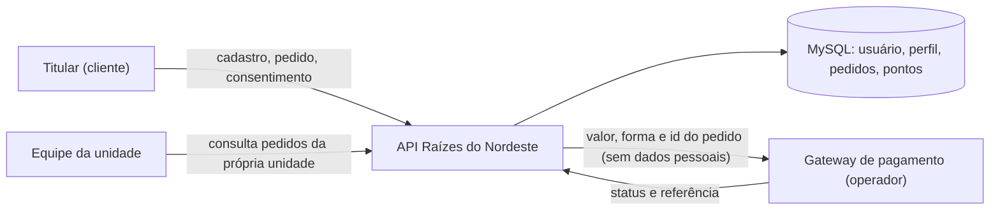

# LGPD, privacidade e segurança

Documento de conformidade técnica da API da rede Raízes do Nordeste com a Lei Geral de
Proteção de Dados Pessoais (Lei nº 13.709/2018). Descreve quais dados são coletados, para quê,
com qual base legal, como o consentimento é registrado e quais controles existem.

> **Aviso:** as bases legais e os prazos de retenção são a proposta técnica do projeto e
> devem ser validados pela área jurídica e contábil da empresa antes de produção.

## 1. Papéis

| Papel (LGPD) | Quem |
|---|---|
| Controlador | Rede Raízes do Nordeste |
| Operador | Provedor do gateway de pagamento (simulado neste projeto) e provedor de infraestrutura |
| Encarregado (DPO) | A designar pela empresa (art. 41). Fora do escopo técnico |
| Titular | Cliente da rede. Funcionários têm dados mínimos de acesso (nome, e-mail e perfil) |

## 2. Inventário de dados pessoais

| Dado | Onde fica | Titular | Finalidade | Base legal (art. 7º) |
|---|---|---|---|---|
| Nome | `usuario.nome` | Cliente e funcionário | Identificação | V: execução de contrato |
| E-mail | `usuario.email` (único, em minúsculas) | Cliente e funcionário | Identificação e login | V: execução de contrato |
| Senha | `usuario.senha_hash` | Cliente e funcionário | Autenticação | V: execução de contrato |
| Perfil e unidade | `usuario.role`, `usuario.unidade_id` | Funcionário | Controle de acesso | V: execução de contrato |
| Data de nascimento (opcional) | `cliente_perfil.data_nascimento` | Cliente | Campanhas segmentadas por faixa etária | I: consentimento |
| Registro de consentimento | `cliente_perfil.consentimento_*` | Cliente | Comprovar o consentimento | II: obrigação legal e I |
| Histórico de pedidos | `pedido`, `item_pedido` (liga ao usuário) | Cliente | Prestar o serviço e atender obrigações fiscais | V e II |
| Uso do histórico em campanhas | Mesmas tabelas | Cliente | Promoções e fidelização | I: consentimento |
| Pontos de fidelidade | `fidelidade_movimento` | Cliente | Programa de fidelização | I: consentimento |
| Resultado do pagamento | `pagamento` (status, valor, referência externa, payload do gateway) | Cliente | Registrar a cobrança | V: execução de contrato |

**Dados que a API não coleta nem guarda:** número de cartão, CPF, endereço, telefone,
geolocalização e endereço IP. O gateway recebe apenas valor, forma de pagamento e identificador do
pedido, **sem nenhum dado pessoal**.

## 3. Consentimento

O consentimento cobre o **programa de fidelidade** (acúmulo de pontos, resgate e uso do histórico
em campanhas). Ele é livre, específico e revogável.

| Aspecto | Como é tratado |
|---|---|
| Como se concede | `POST /fidelidade/consentimento`, ato explícito do próprio cliente autenticado |
| O que é registrado | `consentimento_fidelidade` (estado atual), `consentimento_em` (data da concessão) e `consentimento_revogado_em` |
| Revogação | `DELETE /fidelidade/consentimento`, a qualquer momento e com o mesmo esforço da concessão |
| Idempotência | Repetir a chamada não altera a data original |
| Sem consentimento | O cliente compra e paga normalmente. Não acumula nem resgata pontos (resgate: 409 `CONSENTIMENTO_NECESSARIO`) |
| Após a revogação | Interrompe o acúmulo e o resgate. O histórico de pontos é preservado |
| Quem pode | Somente o perfil CLIENTE, sobre si mesmo. Nenhuma rota recebe o identificador de outro cliente |
| Campanhas (RN17) | Documentadas: usam data de nascimento e frequência, **apenas** de quem consentiu |

**Limitação:** o texto do termo e a sua versão não são armazenados. A prova atual é a data. Evolução:
guardar `versao_termo` junto ao consentimento.

## 4. Direitos do titular (art. 18)

| Direito | Atendimento | Situação |
|---|---|---|
| Confirmação e acesso | `GET /clientes/me` | Implementado |
| Correção | `PUT /clientes/me` (data de nascimento) | Implementado. Nome e e-mail ainda não são editáveis |
| Anonimização, bloqueio ou eliminação | `DELETE /clientes/me` | Implementado (seção 5) |
| Revogação do consentimento | `DELETE /fidelidade/consentimento` | Implementado |
| Informação sobre a possibilidade de não consentir | Regra de negócio: comprar não depende de consentir | Implementado |
| Portabilidade | Não há exportação dos dados | **Não implementado** |
| Informação sobre compartilhamento | O único compartilhamento é com o gateway (valor, forma e id do pedido) | Documentado |

## 5. Anonimização da conta

`DELETE /clientes/me` anonimiza em vez de apagar, porque os pedidos precisam permanecer para
histórico da loja e obrigações fiscais.

| Campo | Depois da anonimização |
|---|---|
| `usuario.nome` | "Cliente anonimizado" |
| `usuario.email` | `anonimizado-{id}@anonimizado.invalid` (domínio reservado, que nunca resolve) |
| `usuario.senha_hash` | Hash de um valor aleatório que ninguém conhece |
| `usuario.ativo` | `false`, e **o token já emitido deixa de valer** (o filtro ignora conta inativa) |
| `cliente_perfil.data_nascimento` | Removida |
| `cliente_perfil.consentimento_fidelidade` | `false`. A data do consentimento é mantida como prova |
| `cliente_perfil.anonimizado_em` | Data da operação |
| `pedido`, `item_pedido`, `pagamento` | Mantidos, sem identificar mais a pessoa |
| `fidelidade_movimento` | Mantido, sem identificar mais a pessoa |

Os pedidos de uma mesma conta anonimizada continuam ligados entre si por um identificador interno.
Se isso configura anonimização plena ou pseudonimização é uma avaliação jurídica.

## 6. Controles técnicos mínimos

| Controle exigido | Implementação | Situação |
|---|---|---|
| Hash de senha | BCrypt, fator de custo 10, com *salt* automático. A senha nunca é registrada em log nem devolvida | Implementado |
| Autenticação por token | JWT assinado (HS256) com expiração de 60 minutos. A API é sem estado | Implementado |
| Autorização por perfil | Regras por rota (RBAC), mais escopo de unidade e de titularidade nos serviços. Negar por padrão | Implementado |
| Perfil sempre atual | Usuário recarregado do banco a cada requisição. Desativar ou rebaixar alguém vale de imediato | Implementado |
| Respostas sem exposição indevida | DTOs de resposta nunca incluem `senha_hash`. O cadastro público não aceita escolher o perfil | Implementado |
| Sem enumeração de usuários | Login com mensagem única para e-mail inexistente, usuário inativo e senha errada | Implementado |
| Erros sem detalhes internos | O tratador genérico devolve mensagem neutra. O cliente vê 404 (e não 403) no pedido de outra pessoa | Implementado |
| Minimização | Dados do cliente em tabela própria. Nenhum dado de cartão. O gateway não recebe dados pessoais | Implementado |
| Rastreabilidade parcial | Movimentações de estoque com usuário e pedido, extrato de pontos e cada tentativa de pagamento | Parcial |
| **Logs de acesso a dados sensíveis** | Não existe auditoria dedicada | **Não implementado** |
| Estratégia de retenção | Proposta na seção 7. Sem rotina automática | Proposto |

## 7. Retenção (proposta a validar)

| Dado | Prazo proposto | Observação |
|---|---|---|
| Conta e perfil ativos | Enquanto durar a relação | Anonimizável a qualquer momento pelo titular |
| Conta sem uso | Anonimizar após 24 meses de inatividade | Exige rotina agendada |
| Pedidos e pagamentos | 5 anos (referência comum para obrigações fiscais) | A validar com a contabilidade |
| Extrato de pontos | Enquanto a conta existir. Anonimizado junto com ela | |
| Registro de consentimento | Enquanto necessário para comprovar | |
| Logs de aplicação | 6 meses | A validar com o jurídico |

## 8. Riscos e lacunas identificados

| # | Risco ou lacuna | Gravidade | Ação |
|---|---|---|---|
| 1 | Sem auditoria nem log de acesso a dados sensíveis (item mínimo do roteiro) | Alta | Implementar auditoria mínima, ou declarar a lacuna |
| 2 | O log de violação de integridade grava a mensagem do banco, que pode conter o e-mail (ex.: "Duplicate entry") | Média | Corrigir: logar só a classe da causa (ver abaixo) |
| 3 | O segredo do JWT tem um valor padrão de desenvolvimento | Média | Em produção, exigir a variável `JWT_SECRET` |
| 4 | Não existe troca de senha, e o administrador inicial nasce com senha de bootstrap | Média | Endpoint de troca de senha |
| 5 | Retenção e anonimização automáticas por inatividade | Média | Rotina agendada |
| 6 | Termo de consentimento sem texto nem versão | Baixa | Guardar a versão |
| 7 | Portabilidade dos dados não implementada | Baixa | Endpoint de exportação |
| 8 | Plano de resposta a incidentes (art. 48) é processo organizacional, fora do código | Baixa | Documentar na empresa |
| 9 | A API local usa HTTP | Baixa | Produção atrás de HTTPS (TLS) |

## 9. Evidências de teste (IDs do roteiro de testes)

| Controle | Teste | Resultado esperado |
|---|---|---|
| Consentimento e acúmulo | L03 a L06 | Sem consentimento o saldo fica em 0. Depois de consentir, os pontos acumulam |
| Revogação | L17 | Depois de revogar, novos pedidos não pontuam |
| Resgate exige consentimento | L18 | 409 `CONSENTIMENTO_NECESSARIO` |
| Acesso e correção | L21, L22, L23 | 200, 200 e 422 (data futura) |
| Anonimização | L24 a L26 | 204. Login e token antigo respondem 401 |
| Sem escalonamento de perfil | U13 | O cadastro público não vira ADMIN |
| Login sem enumeração | T02 e T03 | 401 com a mesma mensagem |
| Perfil sem permissão | U11, P10 e C12 | 403 |
| Privacidade entre clientes | Q09, Q14 | O cliente só vê os próprios pedidos (404 no alheio) |

## 10. Referências

BRASIL. Lei nº 13.709, de 14 de agosto de 2018. Lei Geral de Proteção de Dados Pessoais (LGPD).
Diário Oficial da União, Brasília, DF, 15 ago. 2018.